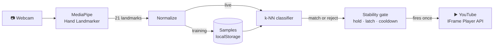

<div align="center">


# GestureFlow

**Teach your browser your own hand gestures, then control YouTube without touching anything.**


</div>

---

## Why

Most gesture controls give you a fixed set of moves someone else picked. If a pose feels awkward or your camera doesn't pick it up well, you're stuck.

GestureFlow turns that around: **you** pick the pose, show it to the camera for a few seconds, and choose what it does. You can control a video when your hands are busy or messy, when you're across the room, or when a keyboard and mouse aren't comfortable to use. Everything happens in the browser, with no account, server or upload.

## What

A web app with a YouTube player on one side and your webcam on the other:

- 🖐️ **Live hand tracking.** 21 landmarks drawn over your webcam feed in real time.
- 🎯 **Train any static pose.** Name it, hold it for about 2 seconds, and it's ready.
- 🎬 **Map it to a player action.** Six actions are available (listed below), and you can train as many gestures as you like.
- 🛡️ **No accidental triggers.** Unknown poses are rejected, and a held gesture fires once rather than repeating.
- 📊 **Built-in tuning view.** Shows live match distances, votes and the threshold, so you can see exactly why a pose did or didn't match.
- 🔗 **Any YouTube video.** Paste a watch link, `youtu.be` link, Shorts link or video ID. Your gestures stay the same.

### Actions

| Action | What it does |
| --- | --- |
| ⏯️ Play / Pause | Toggles playback |
| ⏩ Skip +10s | Jumps forward 10 seconds |
| ⏪ Skip −10s | Jumps back 10 seconds |
| 🔊 Volume up | +10% (and unmutes) |
| 🔉 Volume down | −10% |
| 🔇 Mute / Unmute | Toggles sound |

## Quick start

> Requires **Node 20.19+** or **22.12+**

```bash
npm install
npm run dev
```

Open **http://localhost:5173**, click **Enable camera**, and allow access.

| Script | Purpose |
| --- | --- |
| `npm run dev` | Start the dev server |
| `npm run typecheck` | Type-check with `tsc` |
| `npm run build` | Type-check and build for production |
| `npm run preview` | Serve the production build |

## Train your first gesture

1. Click **+ Train New Gesture**.
2. Pick an action and give the gesture a name.
3. Hold your pose in view during the 3-second countdown.
4. Keep holding while 40 samples are captured. Shift your hand slightly (nearer, farther, small tilts) so it's recognized from more angles.
5. Save, relax your hand once, then show the pose to fire the action.

> 💡 **Good first pair:** ✋ open palm → Play/Pause and ✌️ peace sign → Skip +10s. Pick poses that look clearly different from each other and from a relaxed hand.

## How it works



**1. Normalize.** Landmarks are corrected for the camera's aspect ratio, moved so the wrist is the origin, and scaled by palm size. Where your hand is in the frame and how close it is stop mattering; its orientation still does, so 👍 and 👎 stay different. Training and live recognition share this exact function (`toFeatures` in `src/lib/gesture.ts`).

**2. Classify.** A k-nearest-neighbors search (k = 5) over every stored sample. A match is accepted only if all three checks pass:
- it is close enough (distance ≤ threshold)
- most neighbors agree (≥ 60%)
- it is clearly closer than the next-best gesture (ratio ≤ 0.85)

Anything else is an **Unknown pose** and does nothing.

**3. Trigger.** A match must hold steady for **300 ms** to fire. It then fires **once** and stays locked until you release the pose, with a **1.2 s** cooldown between any two actions (`src/lib/trigger.ts`).

No training pipeline, no GPU, no custom model. Your gesture's "training" is just its recorded samples.

## Tuning

Expand **Tuning & distances** under the camera to see, live:
- each gesture's distance against a threshold marker
- the vote share and the ratio to the runner-up
- the threshold slider

| If… | Then… |
| --- | --- |
| A relaxed hand triggers actions | Lower the threshold |
| Your gesture shows as *Unknown pose* | Raise the threshold, or **Retrain** it |
| Two gestures get mixed up | Retrain one as a more distinct pose |

## Reset

Trained gestures live only in your browser's `localStorage`:

- **One gesture:** use **Retrain** (replaces its samples) or **Delete** on its card.
- **Everything:** run this in the browser console, then reload:

```js
localStorage.removeItem('gestureflow.gestures.v1') // all gestures
localStorage.removeItem('gestureflow.threshold')   // tuning threshold
```

## Privacy

🔒 Webcam frames are processed **entirely in your browser** and are never uploaded or recorded. The only data saved is the landmark coordinates of the gestures you train, in `localStorage`. The hand-tracking model file and the YouTube player are loaded from Google's servers.

## Project structure

```
src/
├── App.tsx                 # Wires tracking → recognition → player
├── components/
│   ├── CameraPanel.tsx     # Webcam view, landmark overlay, camera states
│   ├── TrainPanel.tsx      # Step-by-step gesture recorder
│   ├── StatusPanel.tsx     # Live recognition state + tuning view
│   ├── GestureList.tsx     # Saved gestures (retrain / delete)
│   ├── YouTubePanel.tsx    # Player, manual controls, video switcher
│   └── Icon.tsx
└── lib/
    ├── useHandTracking.ts  # Camera + per-frame detection loop
    ├── handTracker.ts      # MediaPipe setup (GPU with CPU fallback)
    ├── gesture.ts          # Normalization, k-NN classifier, storage
    ├── trigger.ts          # Hold / latch / cooldown state machine
    └── youtube.ts          # IFrame API loader + URL parser
```

## Limitations

- **Static poses only.** No motion gestures such as swipes.
- **One hand at a time.** Gestures are hand-specific, so train with the hand you'll use.
- **The default threshold is a starting point.** Calibrate it for your camera and lighting.
- **Conditions matter.** Poor lighting, busy backgrounds, or a hand partly out of frame reduce accuracy.
- **Autoplay rules.** Browsers may block playback that wasn't started by a click. If they do, press Play once and gestures work from then on.
- **Some videos can't be embedded.** Their owners have disabled embedding.
- **Background tabs pause detection.** It resumes when you return to the tab.
